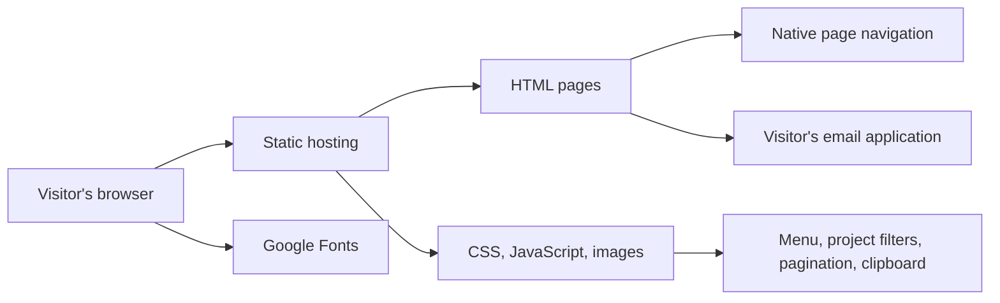

# Tree Operation

**Software development, cybersecurity, and AI automation.**

Tree Operation is a founder-led engineering company based in Prishtina, Kosovo, working with organisations in Europe and the United States. Its team of 15 engineers helps clients build and modernise business systems, protect information, and automate everyday work.

The company combines three areas of responsibility:

| Area | Company focus | Lead |
| --- | --- | --- |
| Software development | Business systems, integration, modernisation, and delivery | Rrezart Prebreza — PhD, Computer Science |
| Cybersecurity | Security architecture, assessments, identity, and access | Besart Prebreza — PhD, Computer Science |
| AI and operations | Knowledge assistants, workflow automation, and IT operations | Qendrim Hykaj — MSc, Computer Science |

Clients can engage a dedicated team, commission a defined project, or bring senior engineers into an existing team. Each engagement has a founder involved, with working hours and delivery arrangements agreed around the client’s needs.

[Company website](https://treeops.net/) · [Contact Tree Operation](mailto:info@treeops.net)

## About this repository

This repository contains the company’s public website. Its purpose is to explain the services, introduce the people responsible for delivery, present selected work, and help prospective clients start a conversation.

The site is a static, multi-page application built with semantic HTML, Bootstrap CSS, custom styles, and vanilla JavaScript. It runs without a package installation, application server, database, or build pipeline.

## Quick start

Prerequisite: Python 3 for the local HTTP server. Any equivalent static HTTP server can be used.

```sh
# Run from the repository root.
python3 -m http.server 4173 --bind 127.0.0.1
```

Open [the local website](http://127.0.0.1:4173/). Stop the server with `Ctrl+C`.

Node.js is optional and is used only for the JavaScript syntax check documented below.

## Site map

| Page | File | Purpose |
| --- | --- | --- |
| Home | `index.html` | Company introduction and links into the site |
| Services | `services.html` | Service scope, examples, benefits, and engagement models |
| Team | `team.html` | Founder profiles, responsibilities, and working practices |
| Work | `work.html` | Project context, categories, and delivery roles |
| FAQ | `faq.html` | Ownership, security, staffing, and commercial questions |
| Contact | `contact.html` | Enquiry guidance, email contact, and next steps |

`tree.html` is a compatibility entry point containing the same homepage as `index.html`.

## Repository structure

```text
.
├── index.html                 # Primary homepage
├── tree.html                  # Compatibility homepage
├── services.html
├── team.html
├── work.html
├── faq.html
├── contact.html
├── assets/
│   ├── css/                   # Shared layout, theme, and page styles
│   ├── images/                # Logo, portraits, and decorative imagery
│   ├── js/
│   │   └── main.js            # Progressive browser interactions
│   └── vendor/
│       └── bootstrap.min.css  # Locally served Bootstrap stylesheet
├── docs/
│   ├── architecture.md        # Runtime, responsibilities, and constraints
│   └── development.md         # Editing, verification, and deployment
└── licenses/
    └── HighTechIT-LICENSE.txt  # Supplied template license
```

## Architecture at a glance



HTML owns the content and navigation. CSS owns presentation and responsive layouts. JavaScript adds small interactions to pages that already contain their content. Enquiries are opened in the visitor’s email application; the site does not submit or store them.

See [Architecture](docs/architecture.md) for the implementation details and [Development](docs/development.md) for maintenance and release guidance.

## Design system

| Role | Value | Use |
| --- | --- | --- |
| Background | `#0e1726` | Deep navy page background |
| Surface | `#132036` | Slate cards and supporting sections |
| Accent | `#4fd1a5` | Mint actions and highlights |
| Primary text | `#e6f4ee` | Headings and primary content |
| Secondary text | `#a5b9b3` | Supporting copy |
| Border | `#293b52` | Dividers and component boundaries |

Saira is used for headings and Inter for body text, with system-font fallbacks. The original company logo and founder portraits are retained. The decorative technology tree supports the brand without carrying essential information.

## Verification

```sh
node --check assets/js/main.js
cmp index.html tree.html
git diff --check
```

These are lightweight checks, not an automated test suite. Follow the browser and content checks in [Development](docs/development.md#verification) before releasing changes.

## Deployment

Publish the root HTML files and the complete `assets/` directory to a static host. Use `index.html` as the default document and serve the other `.html` URLs directly. No single-page application rewrite or build command is needed.

For hosting configuration, caching, and release checks, see [Deployment](docs/development.md#deployment).

## Asset provenance

Bootstrap CSS and the original HighTechIT template were supplied with the project. The template license is retained in `licenses/HighTechIT-LICENSE.txt`; do not assume the company copyright notice replaces third-party license terms. The generated technology-tree image has its generation prompt saved beside the asset. This repository does not declare a separate license for the company’s source code or brand assets.
