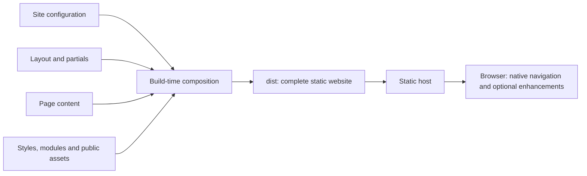

# Tree Operation

**Software development, cybersecurity, and AI automation.**

Tree Operation is a founder-led engineering company based in Prishtina, Kosovo, working with organisations in Europe and the United States. Its team of 15 engineers helps clients build and modernise business systems, protect information, and automate everyday work.

The company combines three areas of responsibility:

| Area | Company focus | Lead |
| --- | --- | --- |
| Software development | Business systems, integration, modernisation, and delivery | Rrezart Prebreza — PhD, Computer Science |
| Cybersecurity | Security architecture, assessments, identity, and access | Besart Prebreza — PhD, Computer Science |
| AI and operations | Knowledge assistants, workflow automation, and IT operations | Qendrim Hykaj — MSc, Computer Science |

Clients can engage a dedicated team, commission a defined project, or bring senior engineers into an existing team. Each engagement has a founder involved, with working hours and delivery arrangements agreed around the client’s needs.

[Company website](https://treeops.net/) · [Contact Tree Operation](mailto:info@treeops.net)

## About this repository

The company website uses a static multi-page architecture with build-time template composition. Shared layouts, navigation, metadata, and browser features have clear owners. The generated website needs only static hosting; no application server or database is required.

## Quick start

Prerequisites: Node.js 20+ and Python 3 (for the preview server). There are no npm package dependencies to install.

```sh
npm run check
npm run preview
```

Open [the local website](http://127.0.0.1:4174/). After editing source, run `npm run build` and refresh. Stop the preview with `Ctrl+C`.

## Repository structure

```text
src/
  data/site.json       # Company settings, page registry, SEO metadata
  layouts/base.html    # Shared HTML document shell
  partials/            # Header, footer, and contact call to action
  pages/               # Page-specific main content
  styles/              # Foundation, components, theme, hero, page layouts
  scripts/
    main.js            # Browser composition entry point
    features/          # Navigation, projects, clipboard, legacy links
public/assets/         # Images and locally bundled Bootstrap CSS
scripts/build.mjs      # Dependency-free static site builder
tests/build.test.mjs  # Generated-site integrity checks
docs/                 # Architecture and maintenance guide
licenses/             # Third-party notices
.github/workflows/     # CI validation and downloadable build artifact
dist/                  # Generated deployment output (gitignored)
```

## Architecture at a glance



The build generates Home, Services, Team, Work, FAQ, and Contact at their existing `.html` URLs. It also generates `tree.html` as a compatibility copy of Home. Navigation and active states come from the page registry; header and footer changes require one edit.

Content stays in HTML. Feature modules enhance the mobile menu, project catalogue, and clipboard without fetching page content. Contact links open the visitor’s email application.

Read [Architecture](docs/architecture.md) for boundaries and patterns, and [Development](docs/development.md) for editing and releases.

## Design system

| Role | Value | Use |
| --- | --- | --- |
| Background | `#0e1726` | Deep navy page background |
| Surface | `#132036` | Slate cards and supporting sections |
| Accent | `#4fd1a5` | Mint actions and highlights |
| Primary text | `#e6f4ee` | Headings and primary content |
| Secondary text | `#a5b9b3` | Supporting copy |
| Border | `#293b52` | Dividers and component boundaries |

Saira is used for headings and Inter for body text, with system-font fallbacks. The original company logo and founder portraits are retained. The decorative technology tree supports the brand without carrying essential information.

## Verification and deployment

`npm test` checks generated pages, metadata, local links and fragments, assets, module imports, project records, and reproducible output. `npm run check` runs those checks and builds the site. GitHub Actions runs the same command on pull requests and pushes to `main`, then uploads the generated site as an artifact.

**Hosting must build with `npm run build` and publish `dist/`.** The repository root is source code, no longer the web root. Existing page URLs are preserved. Pull requests validate and package the site. After a push or merge to `main`, the same workflow publishes the tested `dist/` artifact to GitHub Pages at `https://treeops.net/`. The Pages source must be set to GitHub Actions.

## Asset provenance

Bootstrap CSS and the original HighTechIT template were supplied with the project. The template license is retained in `licenses/HighTechIT-LICENSE.txt`; do not assume the company copyright notice replaces third-party license terms. The generated technology-tree image has its generation prompt saved beside the asset. This repository does not declare a separate license for the company’s source code or brand assets.
